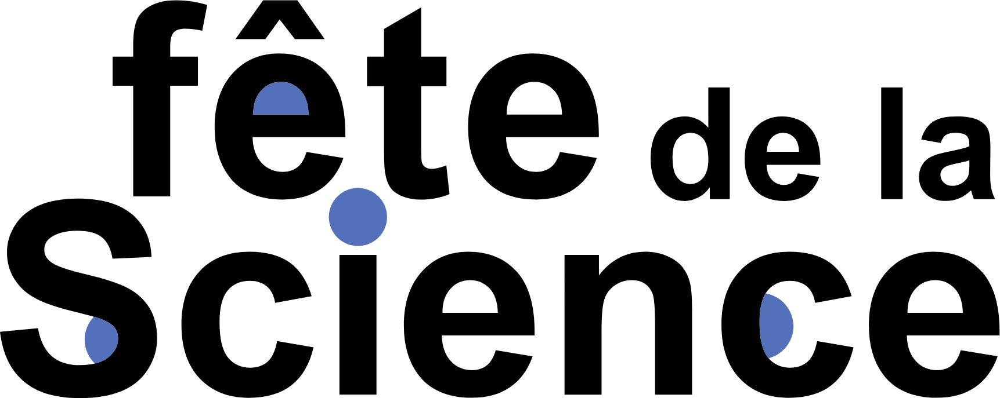
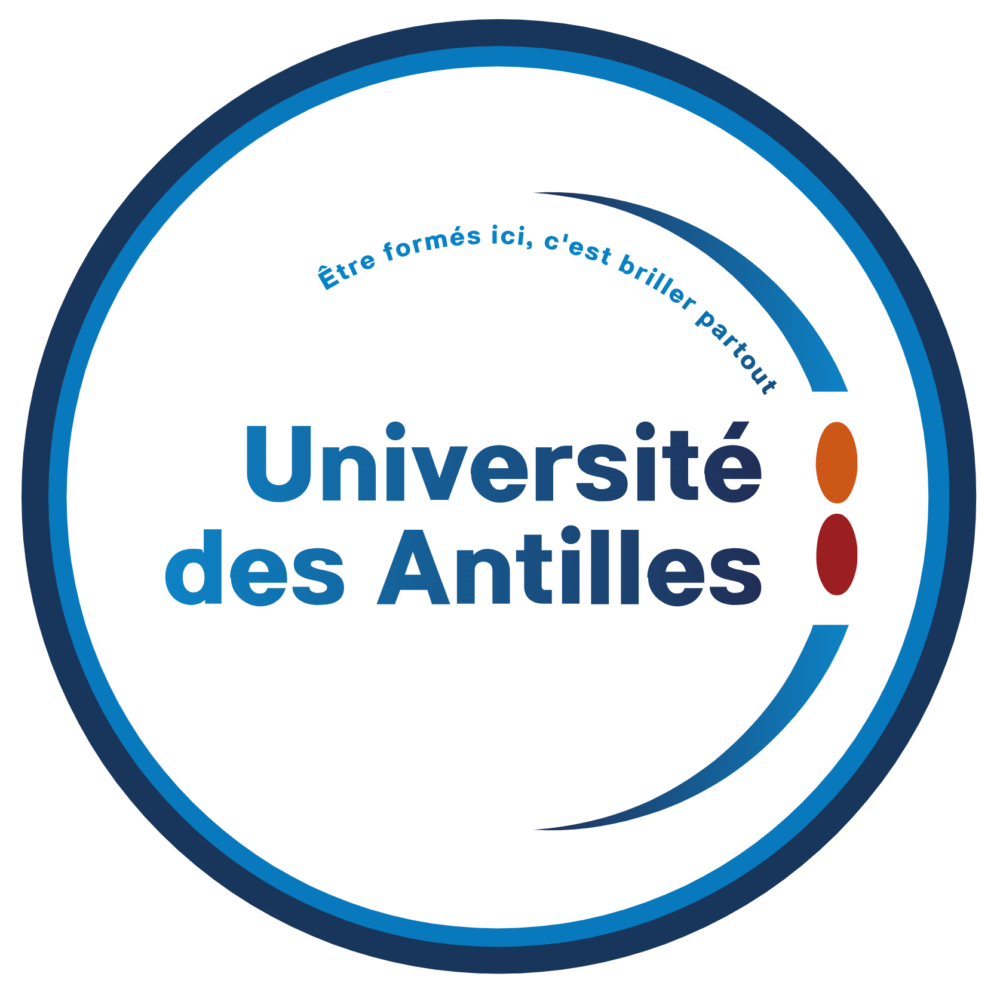

<p align="center">
  
  &nbsp;&nbsp;&nbsp;&nbsp;
  
</p>

<h1 align="center">YOLO cuisto 🍽️</h1>

---

## Sommaire

- [Le projet](#le-projet)
- [Objectifs](#objectifs)
- [Déroulé de l'atelier](#déroulé-de-latelier)
- [Fonctionnement de l'application](#fonctionnement-de-lapplication)
- [Technologies utilisées](#technologies-utilisées)
- [Installation](#installation)
- [Lancement](#lancement)
- [Configuration](#configuration)
- [Organisation du dépôt](#organisation-du-dépôt)
- [Le calcul du score](#le-calcul-du-score)
- [Données et vie privée](#données-et-vie-privée)
- [L'équipe](#léquipe)
- [Remerciements](#remerciements)

---

## Le projet

**YOLO cuisto** est un atelier conçu par cinq doctorants de l'**Université des Antilles** pour la **Fête de la Science 2026**.
Il s'adresse à des groupes de collégiens et de lycéens qui passent environ 15 minutes sur le stand.

Les élèves deviennent l'équipe cuisine de leur collège. Le groupe tire la fiche d'un élève type
(un collégien qui joue au foot, une élève végétarienne, un lycéen qui révise le bac…) et doit composer,
avec des aliments factices de type dînette, **l'assiette de cantine la plus adaptée à ses besoins**.

L'assiette passe ensuite devant une caméra : un modèle d'intelligence artificielle, **YOLO**,
reconnaît les aliments. L'application calcule un **score de proximité** avec les besoins de la fiche
et propose une **recette inventée** à partir des aliments choisis.

L'atelier met en valeur les domaines de recherche de l'équipe : l'informatique et l'intelligence artificielle,
la bio-informatique et la biostatistique (vérification des aliments par leur ADN avec BLASTn)
et les sciences de l'éducation (la cantine comme lieu d'apprentissage et de décision collective).

## Objectifs

- **Faire découvrir l'intelligence artificielle** : montrer comment un modèle reconnaît des objets dans une image,
  et comment un autre modèle peut écrire une recette.
- **Développer l'esprit critique** : l'IA peut se tromper (un aliment caché, mal orienté ou inconnu du modèle).
  Les élèves corrigent eux-mêmes la liste détectée.
- **Sensibiliser à l'équilibre alimentaire** : composer un repas en fonction des besoins d'une personne
  (glucides, fibres, protéines, légumineuses) et des règles d'une cantine (portions maximales).
- **Vivre une décision collective** : le groupe doit se mettre d'accord sur la composition de l'assiette.
- **Montrer la recherche en action** : relier une activité concrète à plusieurs disciplines scientifiques,
  y compris les sciences humaines et sociales.

## Déroulé de l'atelier

| Étape | Ce qui se passe |
| --- | --- |
| 1. Accueil | Tirage de la fiche profil, choix d'un nom d'équipe |
| 2. Composition | Le groupe compose son assiette avec la dînette |
| 3. Vérification BLASTn | Chaque aliment est vérifié grâce à sa séquence d'ADN |
| 4. Passage devant YOLO | Détection des aliments, correction de la liste, calcul du score |
| 5. Sciences de l'éducation | Retour sur la manière dont le groupe a décidé |
| 6. Recette | Découverte de la recette inventée et du classement |

La vérification BLASTn se fait sur un poste à part : elle n'est pas intégrée à cette application.

## Fonctionnement de l'application

L'application est un site web qui tourne sur l'ordinateur du stand. Elle comporte quatre pages :

| Page | Adresse | Rôle |
| --- | --- | --- |
| **Accueil** | `/` | Nom de l'équipe, choix de la fiche tirée (carrousel de cartes), tableau des scores de la journée |
| **Détection** | `/detection` | Caméra en plein écran avec les aliments encadrés par YOLO. Chaque aliment détecté s'ajoute à la liste, que les élèves ajustent avec −, + et ✕ |
| **Résultat** | `/resultat` | Score, comparaison de l'assiette avec les objectifs de la fiche, respect des portions, recette inventée |
| **Fiches** | `/profils` | Les fiches profils et les fiches aliments, en consultation |

```
 Fiche tirée + nom d'équipe
            │
            ▼
 Caméra ──► YOLOE ──► liste des aliments ──► correction par les élèves
                                                    │
                          ┌─────────────────────────┴───────────────┐
                          ▼                                         ▼
               Score de proximité                      Recette inventée
          (apports nutritionnels / fiche)        (Gemini, sinon Ollama en local)
                          └─────────────────────────┬───────────────┘
                                                    ▼
                                         Tableau des scores
```

## Technologies utilisées

| Domaine | Technologie | Utilisation |
| --- | --- | --- |
| Vision par ordinateur | [YOLOE-26](https://docs.ultralytics.com/models/yoloe/) (Ultralytics) | Détection des aliments en temps réel. YOLOE est un modèle « à vocabulaire ouvert » : on lui donne en texte la liste des aliments à chercher, sans réentraînement |
| Apprentissage profond | [PyTorch](https://pytorch.org) + CUDA | Exécution du modèle sur la carte graphique |
| Caméra et images | [OpenCV](https://opencv.org), [Pillow](https://python-pillow.org) | Lecture de la webcam, dessin des cadres et des noms d'aliments |
| Serveur web | [FastAPI](https://fastapi.tiangolo.com), [Uvicorn](https://www.uvicorn.org) | Pages, API et flux vidéo |
| Interface | HTML, CSS et JavaScript, sans framework | Les quatre pages, utilisables sans connexion internet |
| Recettes | [Gemini](https://ai.google.dev) (en ligne) et [Ollama](https://ollama.com) (en local) | Invention d'une recette qui combine les aliments de l'assiette. Si aucun modèle ne répond, une recette de secours est construite sans IA |
| Stockage | Fichiers JSON | Fiches aliments et profils, scores de la journée |

**Matériel utilisé sur le stand** : un ordinateur portable avec une carte graphique NVIDIA (RTX 4060, 8 Go),
une webcam placée au-dessus du plan de travail et des aliments factices.

## Installation

Prérequis : **Python 3.10 ou plus récent**, et idéalement une **carte graphique NVIDIA**.

1. **Installer PyTorch** avec la commande adaptée à votre ordinateur, donnée sur [pytorch.org](https://pytorch.org/get-started/locally/)
   (version CUDA avec une carte graphique NVIDIA, version CPU sinon).
2. **Installer les autres dépendances** :
   ```
   pip install -r requirements.txt
   ```
3. **(Facultatif) Recettes avec Gemini** : créer une clé gratuite sur [Google AI Studio](https://aistudio.google.com/apikey),
   puis la placer dans la variable d'environnement `GEMINI_API_KEY` :
   ```
   setx GEMINI_API_KEY "votre-clé"
   ```
   (sous Windows ; rouvrir ensuite le terminal). La clé ne doit jamais être écrite dans le code.
4. **(Facultatif) Recettes avec Ollama, sans internet** : installer [Ollama](https://ollama.com), puis télécharger le modèle :
   ```
   ollama pull gemma3:4b
   ```

Au premier lancement, YOLOE télécharge ses poids et son encodeur de texte (environ 1 Go) : **internet est nécessaire une fois**.
Ensuite, la détection fonctionne hors ligne.

## Lancement

```
python -m app
```

Ouvrir ensuite **http://localhost:8000** dans un navigateur, de préférence en plein écran (touche F11).

Le modèle YOLOE est chargé au démarrage du serveur. La caméra ne s'allume que lorsque la page de détection est ouverte,
et s'éteint quelques secondes après l'avoir quittée.

## Configuration

Tous les réglages sont regroupés dans [`app/config.py`](app/config.py) :

| Réglage | Rôle |
| --- | --- |
| `CAMERA_INDEX` | Caméra utilisée au démarrage (on peut aussi la changer depuis la page de détection) |
| `MODELE_YOLO` | Modèle de détection : `yoloe-26l-seg.pt` par défaut (tailles n, s, m, l, x) |
| `RESOLUTION_CAMERA` | Résolution demandée à la caméra |
| `TAILLE_IMAGE_YOLO` | Taille de l'image analysée : plus grande, elle aide à voir les petits objets mais ralentit la détection |
| `SEUIL_CONFIANCE` | Confiance minimale pour qu'un aliment soit retenu |
| `BONUS_BON_PROFIL` | Points ajoutés quand l'assiette correspond le mieux à la fiche tirée (50 par défaut) |
| `FOURNISSEURS_RECETTE` | Ordre des modèles de langage essayés pour la recette |
| `OLLAMA_MODELE`, `GEMINI_MODELE` | Modèles de langage utilisés |

Les fiches sont dans le dossier [`data/`](data/) et peuvent être modifiées sans toucher au code :

- [`profils.json`](data/profils.json) : les 10 fiches profils et leurs objectifs nutritionnels ;
- [`aliments.json`](data/aliments.json) : environ 170 aliments, avec leur nom, le texte cherché par YOLOE (`prompt_yolo`),
  leurs apports, leur portion maximale et l'indication des bases d'entraînement qui les contiennent (`connu_yolo`) ;
- [`cahier_des_charges.json`](data/cahier_des_charges.json) : règles de la cantine.

> ⚠️ Les valeurs nutritionnelles actuelles sont **provisoires** et doivent être validées avant le jour de l'atelier.

## Organisation du dépôt

```
FDS_yolocuistot/
├── app/                   Serveur Python
│   ├── main.py            Pages, API et flux vidéo
│   ├── detection.py       Caméra et détection YOLOE (en tâche de fond)
│   ├── scoring.py         Calcul du score
│   ├── recette.py         Recette inventée par un modèle de langage, ou recette de secours
│   ├── stockage.py        Enregistrement des scores
│   ├── donnees.py         Lecture des fiches
│   └── config.py          Réglages
├── static/                Interface web (HTML, CSS, JavaScript)
├── data/                  Fiches profils, fiches aliments, scores de la journée
├── logos/                 Logos de la Fête de la Science et de l'Université des Antilles
└── requirements.txt       Dépendances Python
```

## Le calcul du score

1. On additionne les apports de tous les aliments de l'assiette (en tenant compte des quantités).
2. Pour chaque catégorie (glucides, fibres, protéines, légumineuses), on mesure l'écart en grammes avec l'objectif de la fiche :
   `|objectif − total|`.
3. L'écart total est la somme de ces écarts.
4. Le score de base est `(somme des objectifs − écart total) / somme des objectifs × 100` (minimum 0) :
   un pourcentage de réussite, 100 pour une assiette parfaite, comparable quelle que soit la fiche tirée.
5. **Bonus de +50 points** si, parmi toutes les fiches, celle dont l'assiette est la plus proche est bien la fiche tirée par le groupe.

Le respect des portions maximales de la cantine est affiché, mais ne modifie pas le score.

## Données et vie privée

- Les **images de la caméra ne sont jamais enregistrées** ni envoyées sur internet : elles sont analysées sur l'ordinateur du stand.
- Le tableau des scores ne contient que le **nom d'équipe** choisi par les élèves, la fiche tirée, l'assiette et la recette.
- Pour la recette avec Gemini, seuls la **liste des aliments** et le **nom de la fiche profil** sont envoyés à Google.
  Avec Ollama, rien ne quitte l'ordinateur.
- Pour remettre le tableau des scores à zéro, il suffit de supprimer le fichier `data/scores.json`.

## L'équipe

L'atelier a été imaginé et animé par cinq doctorants de l'Université des Antilles :

| Doctorant·e | Domaine | Contribution à l'atelier |
| --- | --- | --- |
| **Ludivine** | Informatique | Détection des aliments avec YOLO, application web |
| **Ruben** | Informatique | Détection des aliments avec YOLO, application web |
| **Émilie** | Biostatistique | Vérification des aliments par BLASTn, validation des valeurs nutritionnelles |
| **Anne-Sophie** | Bio-informatique | Vérification des aliments par BLASTn, validation des valeurs nutritionnelles |
| **Janice** | Sciences de l'éducation et de la formation | La cantine comme espace éducatif, lecture de la décision collective |

## Remerciements

Nous remercions chaleureusement :

- la **[Fête de la Science](https://www.fetedelascience.fr)**, qui offre chaque année un espace de rencontre entre la recherche et le public ;
- le **laboratoire LAMIA** (Laboratoire de Mathématiques Informatique et Applications) de l'Université des Antilles, pour son soutien ;
- l'**Archipel des Sciences**, centre de culture scientifique, technique et industrielle de Guadeloupe, pour son accompagnement.
